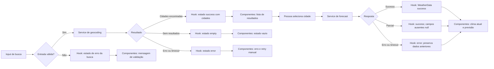

# Plano Técnico — Weather App

## Architecture

Aplicação web client-side, sem backend próprio, dividida em camadas com dependências direcionadas para dentro: `components` depende de contratos e callbacks, `hooks` orquestra estado e casos de uso, `services` encapsula I/O com Open-Meteo, e `lib` contém funções puras de domínio. `types` guarda contratos compartilhados. Nenhuma camada inferior importa componentes React; `lib` não conhece React nem rede.

```text
Pessoa usuária
  -> componentes React
  -> hook de clima (estado e orquestração)
  -> serviços Open-Meteo (geocoding e forecast)
  -> Open-Meteo
  -> normalização/agregação local
  -> estado React
  -> clima atual e previsão
```

As chamadas são feitas diretamente do navegador, sempre por HTTPS. Não há servidor intermediário, autenticação, persistência de dados, cache ou atualização automática. A arquitetura atende FR1–FR8 e NFR1–NFR6.

## Tech Stack

| Tecnologia | Uso e justificativa | Rastreabilidade |
| --- | --- | --- |
| React 19 | Composição da interface e estado transitório dos fluxos. Já faz parte do repositório. | FR1–FR8 |
| TypeScript strict | Contratos explícitos para domínio e respostas externas; reduz erros de mapeamento. | FR2–FR8 |
| Vite | Servidor de desenvolvimento e build da aplicação web existente. | Plataforma web; NFR1, NFR3 |
| Tailwind CSS | Layout responsivo com o tema dark glassmorphism definido nas instruções do projeto. | NFR1 |
| Vitest + Testing Library | Testes de funções, componentes e interação acessível. | FR1–FR8; NFR2 |
| Playwright | Testes de fluxo no Google Chrome em Ubuntu 22.04. | NFR3 |
| `@axe-core/playwright` (dev dependency) | Auditoria automatizada de regras WCAG nas páginas e estados principais. | NFR2 |
| pnpm + Biome | Gerenciamento de pacotes, lint e formatação conforme configuração do repositório. | Manutenibilidade do projeto |

Não adicionar biblioteca de estado, cliente HTTP ou camada de cache: `fetch`, hooks React e funções puras atendem ao escopo sem estado compartilhado persistente.

## Project Structure

```text
src/
├── App.tsx                    # composição da página
├── components/
│   ├── SearchBar.tsx           # apresentação da entrada; emite submit
│   ├── CityResults.tsx         # apresenta e emite seleção de cidade
│   ├── CurrentWeather.tsx      # apresenta clima atual e campos indisponíveis
│   ├── ForecastList.tsx        # apresenta os cinco dias
│   ├── UnitToggle.tsx          # emite escolha de unidade da sessão
│   └── states/                 # componentes de loading, erro, timeout e vazio
├── hooks/
│   └── useWeather.ts           # casos de uso, estado e chamadas aos serviços
├── services/
│   └── openMeteoService.ts     # URLs, parâmetros, fetch, abort e respostas do provedor
├── lib/
│   ├── citySearch.ts           # validação, normalização e ordenação de candidatos
│   ├── weatherMapper.ts        # mapeamento puro de DTOs para modelos de domínio
│   ├── dailyAggregation.ts     # agregações por data no fuso local
│   ├── temperature.ts          # conversão e arredondamento
│   └── format.ts               # formatação de datas, horários e valores pt-BR
└── types/
  └── weather.ts              # modelos de domínio e tipos de estado
```

**Limites de responsabilidade:**

- `components` recebe dados já prontos para apresentar e comunica ações por callbacks. Não faz `fetch`, não ordena respostas e não contém regras de conversão.
- `hooks` coordena busca, seleção, consulta, retry manual, atualização e estados loading/empty/error. Não constrói URLs nem interpreta campos específicos do JSON do provedor.
- `services` é a única camada com I/O: constrói chamadas Open-Meteo, aplica timeout/cancelamento e devolve DTOs de resposta. Não importa componentes nem contém regras visuais.
- `lib` implementa funções determinísticas sem efeitos colaterais: valida/normaliza a busca, ordena candidatos, mapeia DTOs, agrega horas por dia local e converte/formata valores.
- `types` define contratos compartilhados; não contém comportamento.

**Como isso facilita os testes:** `lib` é testada unitariamente com entradas e saídas fixas, sem mocks de rede. `services` é testada com `fetch` controlado para verificar URL, parâmetros, timeout e parsing de HTTP. `hooks` é testado com serviços simulados para cobrir transições de estado e retry. `components` é testado isoladamente com props e callbacks usando Testing Library; Playwright valida o fluxo integrado (FR1–FR8, NFR2–NFR3).

## Data Model

Contratos de domínio. Respostas HTTP do provedor devem ser validadas e mapeadas antes de chegarem aos componentes.

```ts
type Unit = "celsius" | "fahrenheit";

interface City {
  providerId: number; // ID da localidade retornado pelo geocoding.
  name: string; // Nome da cidade retornado pelo provedor.
  country: string; // País usado para identificar a localidade.
  region?: string; // Estado ou região administrativa, quando disponível.
  latitude: number; // Latitude usada na consulta meteorológica.
  longitude: number; // Longitude usada na consulta meteorológica.
  timezone: string | null; // Fuso IANA de geocoding; fallback se forecast não retornar fuso.
}

interface CurrentWeather {
  temperatureC: number | null; // Temperatura instantânea em Celsius.
  relativeHumidityPercent: number | null; // Umidade relativa instantânea, em porcentagem.
  windSpeedKmh: number | null; // Velocidade instantânea do vento, em km/h.
  windDirectionDegrees: number | null; // Direção instantânea do vento, em graus.
  windGustKmh: number | null; // Rajada atual, em km/h.
  precipitationLastHourMm: number | null; // Precipitação na última hora, em mm.
  surfacePressureHpa: number | null; // Pressão atmosférica de superfície, em hPa.
  observedAt: string | null; // Instante da observação normalizado para ISO 8601 UTC.
}

interface ForecastDay {
  localDate: string; // Data local YYYY-MM-DD no fuso da cidade.
  temperatureMeanC: number | null; // Temperatura média diária, em Celsius.
  relativeHumidityMeanPercent: number | null; // Umidade relativa média diária, em porcentagem.
  windMeanKmh: number | null; // Velocidade média diária do vento, em km/h.
  windDirectionDominantDegrees: number | null; // Direção predominante do vento, em graus.
  windGustMaxKmh: number | null; // Rajada máxima do dia, em km/h.
  precipitationSumMm: number | null; // Precipitação acumulada no dia, em mm.
  precipitationProbabilityMaxPercent: number | null; // Probabilidade máxima diária de precipitação, em porcentagem.
}

interface WeatherData {
  city: City; // Localidade selecionada para esta consulta.
  current: CurrentWeather | null; // Condições atuais; null se não houver resposta atual.
  forecast: ForecastDay[]; // Até cinco datas consecutivas no fuso local da cidade.
  lastSuccessfulQueryAt: string; // Conclusão da última consulta válida, em ISO 8601 UTC.
}
```

Campos meteorológicos podem ser `null` quando o provedor não os retorna; a interface os apresenta como “Indisponível” (AC-FR3.2, AC-FR4.3). A temperatura interna permanece em Celsius; `Unit` controla somente sua apresentação (FR5). `observedAt` é normalizado com o fuso e deslocamento UTC fornecidos pelo provedor; `lastSuccessfulQueryAt` é o instante UTC em que a resposta válida foi concluída e é formatado para pt-BR no fuso local da cidade (FR8). O estado desatualizado não é armazenado em `WeatherData`: é derivado de `WeatherState.status === "error"` com `previous` presente.

## Data Flow

1. A pessoa digita e envia o nome da cidade. O cliente remove espaços externos e rejeita campo vazio, caracteres de controle e pontuação fora da lista permitida (FR1).
2. O serviço chama o endpoint de geocoding com o texto codificado como parâmetro de URL e timeout total de 5 segundos.
3. O serviço mapeia candidatos, ordena com `Intl.Collator("pt-BR")`, desempata por país, região e ID, e apresenta até dois resultados (FR2). A seleção mantém `providerId` e coordenadas.
4. Após seleção, o serviço solicita clima atual e previsão. Usar o fuso IANA do forecast; se ausente, usar `City.timezone` do geocoding. Se ambos estiverem ausentes, não calcular previsão local. As datas são agrupadas nesse fuso; médias usam todas as amostras horárias válidas do dia, sem presumir 24 amostras.
5. A resposta é validada e mapeada para `WeatherData`. Dados parciais permanecem utilizáveis, com campos ausentes como `null`.
6. O hook atualiza o estado React. A unidade escolhida altera apenas a formatação, sem nova chamada. Uma atualização manual bem-sucedida substitui os dados e seu horário de sucesso.
7. Em falha de atualização, mantém-se o último `WeatherData` em `WeatherState.error.previous`; a UI deriva o rótulo “Desatualizado” desse estado e mostra o horário da última consulta bem-sucedida. Recarregar a página perde esse estado, conforme NFR4.



## External APIs

### Geocoding

- **Endpoint:** `https://geocoding-api.open-meteo.com/v1/search`
- **Parâmetros:** `name` (nome validado), `count=100` (candidatos para ordenação local), `language=pt`, `format=json`.
- **Campos usados:** `id`, `name`, `country`, `admin1`, `latitude`, `longitude`, `timezone`.
- Após ordenar os candidatos recebidos, a interface apresenta no máximo dois. Se nome, país e região não distinguirem resultados, usa coordenadas como desambiguação (FR2).

### Forecast

- **Endpoint:** `https://api.open-meteo.com/v1/forecast`
- **Identificação do local:** `latitude` e `longitude` da cidade selecionada.
- **Parâmetros:**

```text
current=temperature_2m,relative_humidity_2m,wind_speed_10m,wind_direction_10m,wind_gusts_10m,precipitation,surface_pressure
hourly=temperature_2m,relative_humidity_2m,wind_speed_10m
daily=wind_direction_10m_dominant,wind_gusts_10m_max,precipitation_sum,precipitation_probability_max
forecast_days=5
timezone=auto
temperature_unit=celsius
wind_speed_unit=kmh
precipitation_unit=mm
pressure_unit=hPa
```

- `timezone=auto` solicita ao provedor o fuso correspondente às coordenadas. Usar o fuso IANA da resposta forecast; se ausente, usar `City.timezone` do geocoding como fallback. Se ambos estiverem ausentes, aplicar AC-FR4.4 sem produzir previsão datada.
- Temperatura e umidade médias e velocidade média do vento são calculadas localmente com as observações horárias de cada data local. Direção predominante, rajada máxima, precipitação acumulada e probabilidade máxima usam os campos diários solicitados.
- Consultas não incluem chave de API, localização do dispositivo, analytics nem dados pessoais. Requisições são feitas somente por HTTPS (NFR4, NFR6).

### Exemplos resumidos e mapeamento

Geocoding usa `name`, `count`, `language` e `format`; `current`, `daily` e `timezone` não são parâmetros desse endpoint. A resposta pode incluir `timezone` como dado da localidade.

```json
{
  "results": [
    {
      "id": 2267057,
      "name": "Lisbon",
      "latitude": 38.7167,
      "longitude": -9.1333,
      "timezone": "Europe/Lisbon",
      "country": "Portugal",
      "admin1": "Lisbon"
    }
  ]
}
```

| Resposta de geocoding | Modelo | Mapeamento |
| --- | --- | --- |
| `id` | `City.providerId` | ID da localidade no provedor. |
| `name`, `country`, `admin1` | `City.name`, `country`, `region` | Nome, país e estado/região opcional. |
| `latitude`, `longitude` | `City.latitude`, `longitude` | Coordenadas para forecast e desambiguação. |
| `timezone` | `City.timezone` | Fuso IANA de geocoding usado como fallback se o forecast não retornar um fuso. |

Exemplo de forecast (amostras e dias reduzidos a um elemento; a resposta real contém arrays completos):

```json
{
  "latitude": 38.72,
  "longitude": -9.14,
  "timezone": "Europe/Lisbon",
  "utc_offset_seconds": 0,
  "current": {
    "time": "2026-11-05T12:00",
    "temperature_2m": 18.4,
    "relative_humidity_2m": 67,
    "wind_speed_10m": 12.6,
    "wind_direction_10m": 240,
    "wind_gusts_10m": 21.3,
    "precipitation": 0.2,
    "surface_pressure": 1014.2
  },
  "hourly": {
    "time": ["2026-11-05T12:00"],
    "temperature_2m": [18.4],
    "relative_humidity_2m": [67],
    "wind_speed_10m": [12.6]
  },
  "daily": {
    "time": ["2026-11-05"],
    "wind_direction_10m_dominant": [240],
    "wind_gusts_10m_max": [21.3],
    "precipitation_sum": [0.2],
    "precipitation_probability_max": [30]
  }
}
```

| Resposta de forecast | Modelo | Mapeamento |
| --- | --- | --- |
| `current.temperature_2m`, `relative_humidity_2m` | `CurrentWeather.temperatureC`, `relativeHumidityPercent` | Temperatura instantânea em °C e umidade em %. |
| `current.wind_speed_10m`, `wind_direction_10m`, `wind_gusts_10m` | Campos de vento de `CurrentWeather` | Velocidade/rajada em km/h e direção em graus. |
| `current.precipitation`, `surface_pressure`, `time` | `precipitationLastHourMm`, `surfacePressureHpa`, `observedAt` | Precipitação na hora anterior em mm, pressão em hPa e horário da observação. |
| `hourly.time` | `ForecastDay.localDate` | Agrupar observações pela data no fuso local retornado. |
| `hourly.temperature_2m`, `relative_humidity_2m`, `wind_speed_10m` | Campos `*Mean*` de `ForecastDay` | Média das observações válidas de cada dia local. |
| `daily.wind_direction_10m_dominant`, `wind_gusts_10m_max`, `precipitation_sum`, `precipitation_probability_max` | Campos correspondentes de `ForecastDay` | Direção em graus, rajada em km/h, precipitação em mm e probabilidade em %. |
| Metadados `timezone`, `utc_offset_seconds` | `City.timezone`, `observedAt` e formatação | Fuso forecast tem precedência; offset normaliza `current.time` para UTC. Nunca usar o fuso do dispositivo como fallback. |

`WeatherData.city` vem da seleção de geocoding; `current` e `forecast` vêm dos mapeamentos acima; `lastSuccessfulQueryAt` é o instante UTC de conclusão da resposta válida. `observedAt` também é normalizado para UTC a partir do horário local e do offset retornados pelo provedor; ambos são exibidos no fuso local da cidade. O estado desatualizado é derivado de `WeatherState.error.previous`, não armazenado em `WeatherData`. `Unit` não vem da API: controla somente a apresentação Celsius/Fahrenheit. Campos ausentes tornam-se `null`, conforme AC-FR3.2 e AC-FR4.3.

## State Management

O estado da aplicação vive em um hook `useWeather`, em memória durante a sessão. `App` compõe a tela sem duplicar estado; componentes recebem dados e callbacks. O texto ainda não enviado do campo de busca pode permanecer local em `SearchBar`. Não usar Context, biblioteca global ou armazenamento persistente para este escopo.

```ts
type SearchState =
  | { status: "idle" }
  | { status: "loading" }
  | { status: "success"; cities: City[] }
  | { status: "empty" }
  | { status: "error"; error: WeatherError };

type WeatherError =
  | { kind: "network" }
  | { kind: "api"; statusCode?: number }
  | { kind: "timeout" }
  | { kind: "invalid-response" };

type WeatherState =
  | { status: "idle" }
  | { status: "loading"; city: City; previous?: WeatherData }
  | { status: "success"; data: WeatherData }
  | { status: "error"; city: City; error: WeatherError; previous?: WeatherData };
```

Estados explícitos: `idle` antes da primeira ação; `loading` enquanto a operação aguarda; `success` quando há resultados válidos; `empty` somente para busca sem cidades; e `error` para falha. Busca e clima têm estados separados, portanto zero resultados nunca é tratado como falha. Durante atualização, `previous` conserva o último `WeatherData` bem-sucedido. O estado desatualizado é derivado exclusivamente de `WeatherState.error.previous`, evitando duplicação em um booleano do modelo (FR6–FR8).

`Unit` (`"celsius" | "fahrenheit"`) também vive em `useWeather`, começa em Celsius e não é persistido. O modelo mantém temperaturas-base em Celsius. Na renderização, um helper puro deriva o valor apresentado: Celsius usa o valor-base; Fahrenheit calcula `C × 9/5 + 32`; em ambos os casos, a formatação aplica uma casa decimal e arredondamento especificado em FR5. A conversão não altera `WeatherData` e não dispara novo request.

## Error Handling

- **Rede:** erro de DNS, conexão ou CORS produz `WeatherError.kind = "network"`; não classificar como busca vazia. Mostrar mensagem clara e ação de retry manual.
- **API:** resposta HTTP fora de 2xx produz `kind = "api"` (preservando status quando disponível). JSON inválido, estrutura inesperada ou campos incompatíveis produzem `kind = "invalid-response"`. Não expor detalhes internos do provedor na mensagem ao usuário.
- **Timeout:** limitar cada operação iniciada pela pessoa a 5 segundos no total; cancelar com `AbortController`, ignorar respostas tardias, definir `kind = "timeout"` e oferecer retry manual. Não há retry automático (FR6–FR7).
- **Geocoding vazio:** usar `SearchState.status = "empty"` e a mensagem “Cidade não encontrada. Verifique a grafia e tente novamente.”; não iniciar forecast.
- **Resposta parcial:** mapear campos ausentes para `null`, exibir “Indisponível” nesses campos e manter os campos válidos. Payload parcial utilizável continua em `success`; ausência de todos os dados essenciais por resposta inválida é `invalid-response` (AC-FR3.2, AC-FR4.3).
- **Falha ao atualizar:** manter `previous`, comunicar a falha e preservar `lastSuccessfulQueryAt`; a UI mostra “Desatualizado” quando há `previous` no estado de erro. Substituir os dados apenas após resposta válida (FR8).
- **Fuso ausente:** manter clima atual quando disponível; não usar o fuso do dispositivo para inventar datas e informar que a previsão local está indisponível (AC-FR4.4).
- **Dados externos:** codificar o texto de busca com `URLSearchParams`, renderizar valores externos como texto e nunca como HTML (NFR6).

## Testing Strategy

### Vitest

- **Funções puras:** testar conversão Celsius/Fahrenheit, arredondamento para uma casa decimal e casos negativos/tie; normalização Unicode e espaços; rejeição de caracteres inválidos; collation e desempate de cidades; agregação horária por data local, incluindo mudança de dia e amostras ausentes; mapeamento de campos parciais para `null`; formatação de datas pt-BR.
- **Services com `fetch` mockado:** substituir `globalThis.fetch` por respostas determinísticas e verificar URLs/parâmetros dos endpoints, mapeamento de payloads, status HTTP não-2xx, JSON inválido, falha de rede, timeout/abort após 5 segundos e descarte de resposta tardia. Não depender da disponibilidade real do Open-Meteo nos testes unitários.
- **Componentes e hook com Testing Library:** cobrir `idle`, `loading`, `success`, `error` e `empty`; busca enviada por ação, seleção, mensagem sem resultados, mensagem de erro e timeout; campos parciais “Indisponível”; toggle de unidade sem nova chamada; retry manual; atualização falha preservando dados anteriores como desatualizados. Incluir interação por teclado nos controles principais.
- **Acessibilidade:** usar `@axe-core/playwright` como dev dependency para auditar páginas e estados principais contra regras WCAG 2.2 AA. Complementar a automação com testes manuais de teclado, foco e leitor de tela; automação não comprova conformidade integral.

### Playwright

- Executar usando o canal `chrome` do Playwright em Ubuntu 22.04, alinhado a NFR3.
- Interceptar os endpoints Open-Meteo com fixtures determinísticas para evitar flakiness e cobrir também respostas HTTP, timeout e payload parcial.
- Fluxos E2E: buscar e selecionar cidade; abrir clima atual e cinco dias; alternar unidade sem nova requisição; busca vazia/sem resultados; atualizar manualmente; falha e retry; manter dados anteriores e rótulo “Desatualizado”.
- Repetir os fluxos principais em viewports 320 × 640 px, 390 × 844 px e desktop 1280 × 800 px; verificar ações essenciais, ausência de rolagem horizontal e acesso por teclado.

### Usabilidade

Avaliar o sucesso do produto exclusivamente por testes de usabilidade com a persona prioritária de planejamento de atividades. Não adicionar telemetria ou analytics (NFR4).

## Risks & Trade-offs

| Decisão / trade-off | Alternativa considerada | Justificativa e custo aceito |
| --- | --- | --- |
| Chamar Open-Meteo diretamente do navegador. | Criar backend/proxy próprio. | Evita infraestrutura e credenciais, conforme a spec; aceita dependência de rede, CORS e disponibilidade do provedor no cliente. |
| Estado transitório em `useWeather` e estado local de input. | Redux/Zustand ou Context global. | O app tem um fluxo e sem persistência; reduz dependências e complexidade. Se surgirem fluxos compartilhados, reavaliar. |
| Não usar cache nem oferecer modo offline. | Cache HTTP/app shell ou Service Worker. | Segue decisão explícita do MVP e evita exibir dados antigos silenciosamente; consultas exigem rede e cada atualização gera request. |
| Manter temperatura-base em Celsius e converter na renderização. | Solicitar novamente a API ao alternar unidade ou armazenar valores em ambas as unidades. | Evita requests e duplicação de estado; exige testes de conversão e arredondamento. |
| Calcular médias diárias das observações horárias no cliente. | Usar apenas agregados diários do provedor ou criar agregação em backend. | Fornece as médias requeridas sem backend; exige agrupamento pelo fuso local e tratamento de dias com número variável de amostras. |
| Mockar Open-Meteo nos testes automatizados. | Fazer os testes E2E dependerem do serviço real. | Produz testes rápidos e determinísticos; a integração real é validada separadamente no ambiente-alvo, pois serviço externo pode variar ou falhar. |
| Timeout total de 5 segundos e retry manual. | Espera mais longa ou retry automático com backoff. | Cumpre FR6–FR7 e impede requests duplicados; redes lentas podem exigir nova ação da pessoa. |
| Fuso retornado pelos endpoints diverge ou está ausente. | Usar o fuso de geocoding como autoridade, ou usar apenas o fuso de forecast sem fallback. | Forecast é a fonte de timezone da resposta meteorológica; geocoding é fallback. Se ambos faltarem, não há previsão diária local. |
| Sem analytics de produção e sem persistência. | Coletar métricas ou guardar preferências/histórico. | Respeita NFR4 e o escopo; adoção é avaliada somente por testes de usabilidade, e estado é perdido ao fechar/recarregar a página. |
